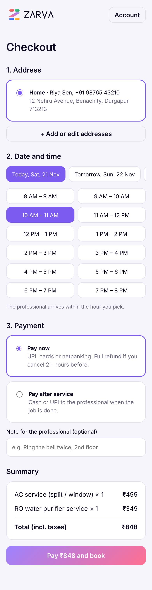
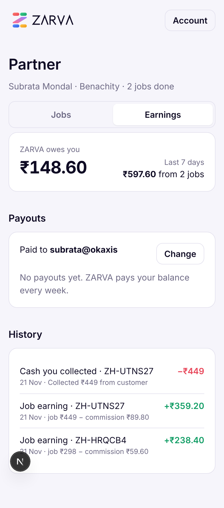

# Home services (vertical `home`)

Urban Company style bookings. Live in **Durgapur** (PIN 713201 to 713216). Asansol and Kolkata are in the database, switched off.

## Try it locally

Nothing extra to set up. Run `pnpm dev` as in the README. On first start the API loads the Durgapur catalogue and, in the built-in demo database only, 8 demo professionals. Sign-in codes print in the terminal.

ZARVA is three separate apps, like Uber's rider and driver apps. Each has its own sign-in, its own screens and its own session, and none shows the others' menus:

| Role | Sign in at | Sign in as | You land on |
|---|---|---|---|
| Customer | http://localhost:3000/login | any number, e.g. 98765 43210 | Home page (new accounts first add a name and phone) |
| Professional | http://localhost:3000/partner/login | 90000 00001 to 90000 00008 (see `seed-data.ts` for who does what) | /pro, the partner app: jobs and earnings |
| New partner signing up | http://localhost:3000/partner → Start sign-up | any new number, e.g. 90000 00099 | /pro, the 4 sign-up steps |
| Admin | http://localhost:3000/admin/login | username `admin`, password `zarva-admin-dev` (created on your own computer only, no authenticator code locally) | /admin |

On the phone the same split holds: **ZARVA** is the customer app and **ZARVA Partner** is the professional's app (one codebase, two store apps, see `apps/mobile/app.config.js`). In Expo Go the app first asks which one to open.

A professional can also be a customer with the same mobile number. Those are two separate sign-ins: signing in to the partner app never opens the customer app, and the customer app never shows jobs or payouts. Each session is stamped with the app it was opened in (`customer`, `partner` or `admin`), and the API refuses any other app's screens with `403 wrong_portal`.

Payments use the mock provider locally: "Pay now" succeeds instantly. To reload the catalogue after editing prices in `seed-data.ts`, run `pnpm db:seed` (add `-- --demo` for demo pros). To start over, stop the API and delete `apps/api/.data`.

## Who can do what (access rules)

All checks happen on the API for every request; hiding a button in the app is never the protection.

- **Customer**: signed in through the customer app. Booking needs a verified mobile number.
- **Professional**: signed in through the partner app, by mobile number only. Anyone can sign up there, but sees no jobs and can't act until an admin approves their KYC. Every partner API re-checks "approved, right city, right category, my job".
- **Admin**: a ZARVA-issued account, not anyone's personal number. There is no admin sign-up: accounts are made by an existing admin (Team tab) or with `pnpm admin:create`. Sign-in is username + password + a 6-digit code from an authenticator app (Google/Microsoft Authenticator). 5 wrong tries lock the account for 15 minutes; a code can't be reused; an admin session lasts 12 hours. Disabling an admin or changing a password ends their other sessions.

**Developer shortcuts** (demo admin `admin` / `zarva-admin-dev`, demo partners, demo Google button, instant mock payments) exist only on a developer's own machine: when sign-in codes are printed to the terminal instead of sent. As soon as real SMS or email is configured, or `NODE_ENV=production`, they all switch off, and the API refuses to start without a real `JWT_SECRET` and Razorpay. An admin without an authenticator can't sign in.

### Set up an admin for a real deployment

Create the first admin once, on the server (on Render: **zarva-api → Shell**):

```
pnpm admin:create ops "Your Name"
```

It prints the username, a start password and an authenticator key. Type or scan the key into Google Authenticator, sign in at `/admin/login`, and change the password under **Team**. Further admins are added from the Team tab; each gets their own start password and key, shown once.

## How it works

- **Catalogue**: 8 categories, 41 services, prices in `apps/api/src/modules/home/seed-data.ts`. Catalogue prices are the professional's quote (minimum order ₹99). See **Pricing** below.
- **Serviceability**: decided by the address PIN code (`home_cities.pincodes`).
- **Slots**: 1-hour arrival windows, 8 AM to 8 PM IST, 7 days ahead, at least 2 hours from now. A slot is free while *bookings in that slot < active pros in that category*. A row lock per slot stops two customers taking the last pro.
- **Payment**: "Pay now" (Razorpay, UPI first) or "Pay after service" (pro collects cash/UPI and marks it). An unpaid online booking holds its slot for 15 minutes. The booking is confirmed by the client callback *or* the webhook, whichever comes first, inside the same database transaction as the payment change.
- **Job flow**: confirmed → pro accepts (or admin assigns) → on the way → pro enters the customer's 4-digit start code → in progress → completed. Before accepting, a pro sees only the area and PIN, not the customer's name, phone or house.
- **Payment**: prepaid only. Every booking is paid online when it is made; pay after service is switched off (old cash bookings still complete normally). While Razorpay has test keys on a live server, bookings are paused. In development the mock checkout pays instantly.
- **Customer cancel / reschedule** (defaults, editable in admin → Pricing & cancellation): the Cancel button is on every open booking (booked, pro assigned, on the way, in progress), switched off with the reason when not allowed. Cancel is allowed at any stage until 90 minutes before the slot, never after, and never once the work has started (raise a ticket instead). Reschedule is free (2 per booking), only before the pro sets off, and puts the job back in the pool for the new time. Cancel refunds the service price and its GST by notice: 24 h+ 100%, 6-24 h 75%, 3-6 h 50%, 90 min-3 h 25%. The platform & convenience fee is never refunded. The app shows the exact refund before confirming; if it changes meanwhile the API answers `quote_changed`. If ZARVA (admin) cancels, everything is refunded.
- **Partner cancellation**: a partner can drop an accepted job until they start it; the booking goes back to the pool and the customer is told. 2 a day are free; from the 3rd that day, 10% (4th 12.5%, 5th+ 15%) of that day's job earnings is deducted, written as a `cancellation_penalty` ledger row after the day ends (India time), so it comes off the weekly payout. At 14 in a Monday-Sunday week the app blocks further cancelling.
- **Admin**: bookings by status, assign/reassign, cancel with reason, review KYC and approve / send back / suspend pros, edit prices and commission, pay pros.
- **Messages**: SMS (and WhatsApp if the customer opted in) at confirmed, pro assigned, on the way, completed, cancelled, refund; partners get new job, job cancelled, approved, sent back, payout account changed, paid. See [notifications.md](notifications.md).

## Partner sign-up and KYC

`/partner` explains the offer; `/pro` is the sign-up, in 4 steps saved as you go:

1. **Your work**: name as on ID, area, categories, years of experience, which ID they'll upload.
2. **ID and photo**: ID proof front (back optional, not shown for PAN), a selfie, optional skill certificate. JPG, PNG or PDF up to 5 MB; phone photos are shrunk to about 1600 px before upload. We ask for **masked Aadhaar** only (UIDAI guidance: don't collect full Aadhaar numbers).
3. **Payout account**: UPI ID, or bank account + IFSC, in their own name.
4. **Submit**, after agreeing to the terms. Status becomes *To review*.

The admin's **Professionals** tab shows each file inline (never cached by the browser), then **Approve** or **Send back** with a reason, which the partner gets by SMS; they fix it and submit again. Approved partners can't change their name or categories themselves. Changing the payout account later is allowed, but sends an SMS warning to the partner, because redirecting payouts is the first thing an account thief would do.

Files are stored in the database, encrypted with AES-256-GCM (`KYC_ENCRYPTION_KEY`), and only admin APIs can read them. Keeping them in Postgres means one thing to back up and no extra storage service at launch; at 30 to 100 partners that is well under 100 MB. Move to S3/R2 if it grows past a few thousand partners.

## Earnings, commission and payouts

Every rupee between ZARVA and a partner is a row in `home_pro_ledger`; rows are never edited, corrections are new rows. The balance is the sum: positive means ZARVA owes the partner, negative means the partner owes ZARVA.

| When | Ledger row |
|---|---|
| Job completed | **+ job price − commission** (commission per category, 20% by default, set in admin → Prices & commission; the convenience fee is always ZARVA's) |
| Job was "pay after service" | also **− total collected**, since the partner kept the customer's cash |
| Admin pays the partner | **− amount** (written before any money moves, so two clicks can't pay twice) |
| Payout failed or bounced | **+ amount** back |
| Admin adjustment | **±** with a note (cash dues received, bonus, penalty) |

Example: fan repair ₹199 paid online gives the partner +₹159.20. The same job paid in cash gives +₹159.20 − ₹228 = −₹68.80 (they hold ₹68.80 of ZARVA's money: ₹39.80 commission + ₹29 fee).

**Paying partners (admin → Payouts):** the list shows every partner's balance. **Pay** creates a payout (minimum ₹100, never more than the balance).
- `PAYOUT_PROVIDER=manual` (default, works today): the payout appears under *To pay now*. Send the money from the business UPI app, type the 12-digit UPI reference (UTR) and press **Mark paid**; the partner gets an SMS. **Couldn't pay** puts the amount back on their balance.
- `PAYOUT_PROVIDER=razorpayx` (after Razorpay KYC and a RazorpayX account): money is sent automatically by UPI or IMPS, and RazorpayX's webhook marks it paid or failed. If RazorpayX refuses, the amount returns to the balance at once; if the result is unknown (timeout), the money stays debited and the payout shows "Status unknown" until the webhook arrives or you check the RazorpayX dashboard, so nothing is ever paid twice.

Partners see their balance, last 7 days, every ledger row with the commission spelled out, and their payouts under **Earnings** in `/pro`.

## Known limits (deliberate for v1)

- Slot capacity counts bookings per slot start only. A 5-hour deep clean blocks its pro for one slot in the capacity count, though the pro still cannot accept two jobs at the same start time. Fix before cleaning volume grows: make capacity duration-aware.
- One price list for all cities. Add per-city prices before Kolkata.
- No push notifications yet (SMS / WhatsApp only); the web and app also poll every 20-30 s.
- Mobile app: customer flow only. "Pay now" works with the mock provider; live Razorpay in the app needs `react-native-razorpay` and an Expo dev build. Until then use "Pay after service" in the app or pay on the web.
- Payouts are created by an admin, not on an automatic weekly schedule. Add a weekly job once volumes justify it.
- Online payments count towards a pro's earnings when the booking is confirmed by the payment, before Razorpay settles to ZARVA (T+2). Pay weekly, not daily, to keep that gap covered.
- Durgapur PIN list and prices should be checked locally before launch.

## Screenshots

| Categories | Checkout | Booking tracking | Partner job | Admin |
|---|---|---|---|---|
|  |  |  |  |  |

| Partner page | Sign-up: documents | Partner earnings | Admin: KYC review | Admin: payouts |
|---|---|---|---|---|
|  |  |  |  |  |

## Pricing (from 22 Nov 2026)

One function, `homeTotals` in `packages/core/src/home-policy.ts`, works out every price. The API stores its result on the booking (`home_bookings.pricing`), and checkout, the booking page, the invoice, refunds and partner earnings all read from it.

| Line | Rule (default, admin-editable) | Quote ₹100 | Quote ₹199 |
|---|---|---|---|
| 1. Service price (base) | professional's quote + 5% | ₹105.00 | ₹208.95 |
| 2. Platform & convenience fee | 6% (Operations) + 3% (Tech) of base, at least ₹15 | ₹15.00 | ₹18.81 |
| 3. GST | 18% of (1 + 2) | ₹21.60 | ₹41.00 |
| Customer pays | 1 + 2 + 3 | ₹141.60 | ₹268.76 |
| Professional earns | quote − 10% commission | ₹90.00 | ₹179.10 |

Customers see one fee line. Admin and the stored breakdown keep it split: service charge 6% is the Operations bucket and platform charge 3% is the Tech bucket. When the ₹15 minimum applies, it is split between them in the same 6:3 ratio.

Rounding: the markup is applied per item; charges and GST are worked out on the whole order. Each amount is rounded to the nearest paisa (half a paisa up), and the total is the sum of the rounded lines, so the bill always adds up.

Refunds: the base price and its share of the GST (18% of the base) come back by the cancellation slab, each rounded down to the paisa. The platform & convenience fee and its share of the GST are never refunded. If ZARVA cancels, everything is refunded.

Rates are set in admin → Pricing & cancellation. A booking keeps the rates it was made with. Bookings made before this change have no `pricing`: their price included GST, a flat ₹29 fee applied, and the category commission is used for the partner's earning.
