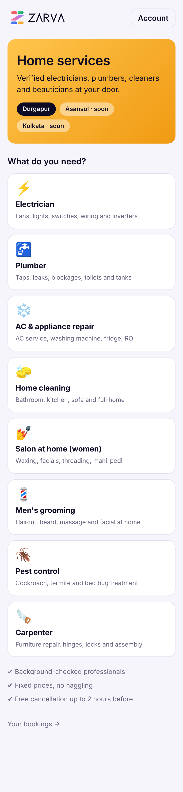
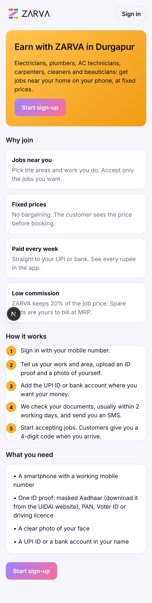
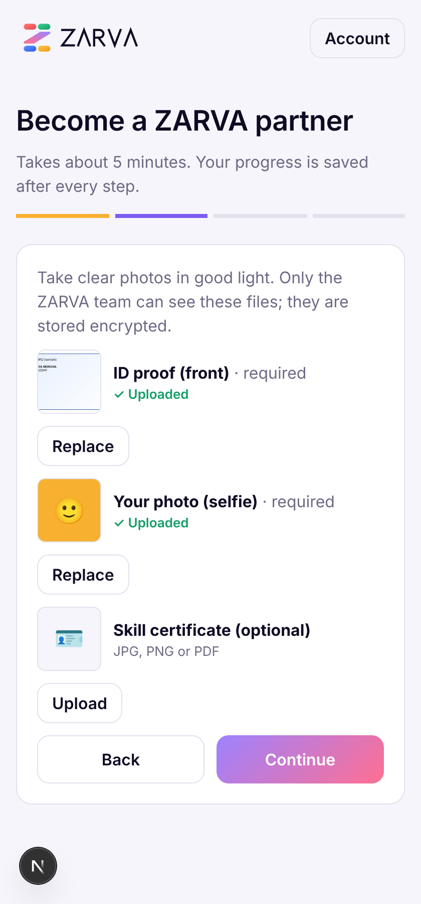
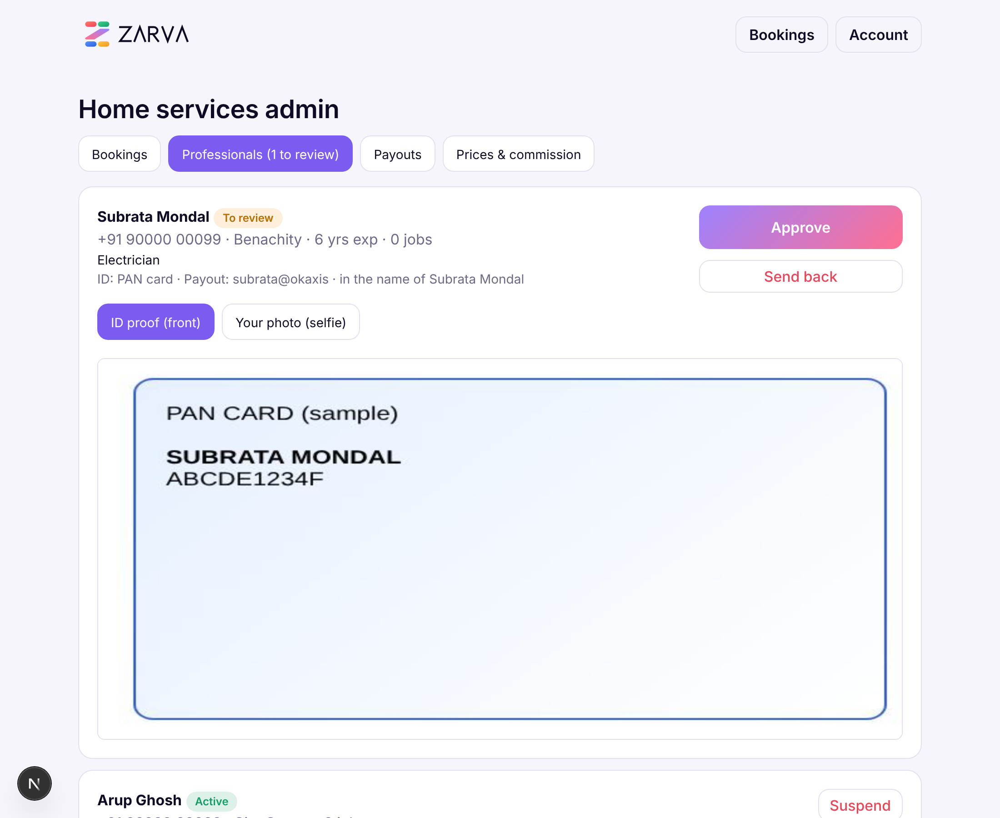
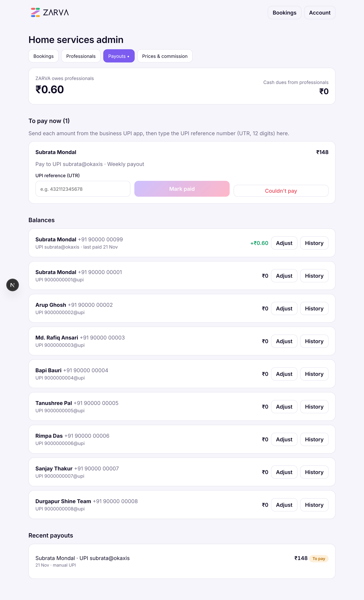

# Home services (vertical `home`)

Urban Company style bookings. Live in **Durgapur** (PIN 713201 to 713216). Asansol and Kolkata are in the database, switched off.

## Try it locally

Nothing extra to set up. Run `pnpm dev` as in the README. On first start the API loads the Durgapur catalogue and, in the built-in demo database only, 8 demo professionals. Sign-in codes print in the terminal.

Everyone has one ZARVA account (a mobile number, plus email or Google for customers). The website has three doors into it, and each one lands you in that role's own home:

| Role | Sign in at | Sign in as | You land on |
|---|---|---|---|
| Customer | http://localhost:3000/login | any number, e.g. 98765 43210 | Home page (new accounts first add a name and phone) |
| Professional | http://localhost:3000/partner/login | 90000 00001 to 90000 00008 (see `seed-data.ts` for who does what) | /pro, the partner app: jobs and earnings |
| New partner signing up | http://localhost:3000/partner → Start sign-up | any new number, e.g. 90000 00099 | /pro, the 4 sign-up steps |
| Admin | http://localhost:3000/admin/login | 99999 00000 (local default, no authenticator code needed locally) | /admin |

The same person can hold several roles (a pro can also book a service); the header then shows links to their other areas. A number that is not an admin is signed straight out of /admin/login. The roles are checked by the API on every request, so the separate pages are about where people land, not about security.

Payments use the mock provider locally: "Pay now" succeeds instantly. To reload the catalogue after editing prices in `seed-data.ts`, run `pnpm db:seed` (add `-- --demo` for demo pros). To start over, stop the API and delete `apps/api/.data`.

## Who can do what (access rules)

All checks happen on the API for every request; hiding a button in the app is never the protection.

- **Customer**: anyone signed in. Booking needs a verified mobile number.
- **Professional**: anyone with a verified mobile can sign up at `/partner`, but sees no jobs and can't act until an admin approves their KYC. Every partner API re-checks "approved, right city, right category, my job".
- **Admin**: three checks on every admin API call:
  1. signed in with a live session,
  2. the account's mobile number is verified by OTP and listed in `ADMIN_PHONES`,
  3. this session was unlocked with a 6-digit code from an authenticator app (Google/Microsoft Authenticator) in the last 8 hours. 5 wrong codes lock it for 15 minutes; a code can't be reused; logging out ends the unlock.

**Developer shortcuts** (demo admin 99999 00000, demo partners, demo Google button, instant mock payments) exist only on a developer's own machine: when sign-in codes are printed to the terminal instead of sent. As soon as real SMS or email is configured, or `NODE_ENV=production`, they all switch off, and the API refuses to start without a real `JWT_SECRET`, Razorpay, and an authenticator secret for every admin.

### Set up an admin for a real deployment

```
pnpm admin:2fa 9876543210
```

Scan or type the key into Google Authenticator on that admin's phone, then put the two printed lines (`ADMIN_PHONES`, `ADMIN_TOTP_SECRETS`) in the server's settings.

## How it works

- **Catalogue**: 8 categories, 41 services, prices in `apps/api/src/modules/home/seed-data.ts`. Prices include GST. Orders under ₹299 pay a ₹29 convenience fee; minimum order ₹99.
- **Serviceability**: decided by the address PIN code (`home_cities.pincodes`).
- **Slots**: 1-hour arrival windows, 8 AM to 8 PM IST, 7 days ahead, at least 2 hours from now. A slot is free while *bookings in that slot < active pros in that category*. A row lock per slot stops two customers taking the last pro.
- **Payment**: "Pay now" (Razorpay, UPI first) or "Pay after service" (pro collects cash/UPI and marks it). An unpaid online booking holds its slot for 15 minutes. The booking is confirmed by the client callback *or* the webhook, whichever comes first, inside the same database transaction as the payment change.
- **Job flow**: confirmed → pro accepts (or admin assigns) → on the way → pro enters the customer's 4-digit start code → in progress → completed. Before accepting, a pro sees only the area and PIN, not the customer's name, phone or house.
- **Cancellation**: free until 2 hours before the slot, with a full automatic refund if paid. After that, only admin can cancel.
- **Admin**: bookings by status, assign/reassign, cancel with reason, review KYC and approve / send back / suspend pros, edit prices and commission, pay pros.
- **Messages**: SMS (and WhatsApp if the customer opted in) at confirmed, pro assigned, on the way, completed, cancelled, refund; partners get new job, job cancelled, approved, sent back, payout account changed, paid. See [notifications.md](notifications.md).

## Partner sign-up and KYC

`/partner` explains the offer; `/pro` is the sign-up, in 4 steps saved as you go:

1. **Your work**: name as on ID, area, categories, years of experience, which ID they'll upload.
2. **ID and photo**: ID proof front (back optional, not shown for PAN), a selfie, optional skill certificate. JPG, PNG or PDF up to 5 MB; phone photos are shrunk to about 1600 px before upload. We ask for **masked Aadhaar** only (UIDAI guidance: don't collect full Aadhaar numbers).
3. **Payout account**: UPI ID, or bank account + IFSC, in their own name.
4. **Submit**, after agreeing to the terms. Status becomes *To review*.

The admin's **Professionals** tab shows each file inline (never cached by the browser), then **Approve** or **Send back** with a reason, which the partner gets by SMS; they fix it and submit again. Approved partners can't change their name or categories themselves. Changing the payout account later is allowed, but sends an SMS warning to the partner, because redirecting payouts is the first thing an account thief would do.

Files are stored in the database, encrypted with AES-256-GCM (`KYC_ENCRYPTION_KEY`), and only admin APIs can read them. Keeping them in Postgres means one thing to back up and no extra storage service at launch; at 30 to 100 partners that is well under 100 MB. Move to S3/R2 if it grows past a few thousand partners.

## Earnings, commission and payouts

Every rupee between ZARVA and a partner is a row in `home_pro_ledger`; rows are never edited, corrections are new rows. The balance is the sum: positive means ZARVA owes the partner, negative means the partner owes ZARVA.

| When | Ledger row |
|---|---|
| Job completed | **+ job price − commission** (commission per category, 20% by default, set in admin → Prices & commission; the convenience fee is always ZARVA's) |
| Job was "pay after service" | also **− total collected**, since the partner kept the customer's cash |
| Admin pays the partner | **− amount** (written before any money moves, so two clicks can't pay twice) |
| Payout failed or bounced | **+ amount** back |
| Admin adjustment | **±** with a note (cash dues received, bonus, penalty) |

Example: fan repair ₹199 paid online gives the partner +₹159.20. The same job paid in cash gives +₹159.20 − ₹228 = −₹68.80 (they hold ₹68.80 of ZARVA's money: ₹39.80 commission + ₹29 fee).

**Paying partners (admin → Payouts):** the list shows every partner's balance. **Pay** creates a payout (minimum ₹100, never more than the balance).
- `PAYOUT_PROVIDER=manual` (default, works today): the payout appears under *To pay now*. Send the money from the business UPI app, type the 12-digit UPI reference (UTR) and press **Mark paid**; the partner gets an SMS. **Couldn't pay** puts the amount back on their balance.
- `PAYOUT_PROVIDER=razorpayx` (after Razorpay KYC and a RazorpayX account): money is sent automatically by UPI or IMPS, and RazorpayX's webhook marks it paid or failed. If RazorpayX refuses, the amount returns to the balance at once; if the result is unknown (timeout), the money stays debited and the payout shows "Status unknown" until the webhook arrives or you check the RazorpayX dashboard, so nothing is ever paid twice.

Partners see their balance, last 7 days, every ledger row with the commission spelled out, and their payouts under **Earnings** in `/pro`.

## Known limits (deliberate for v1)

- Slot capacity counts bookings per slot start only. A 5-hour deep clean blocks its pro for one slot in the capacity count, though the pro still cannot accept two jobs at the same start time. Fix before cleaning volume grows: make capacity duration-aware.
- One price list for all cities. Add per-city prices before Kolkata.
- No push notifications yet (SMS / WhatsApp only); the web and app also poll every 20-30 s.
- Mobile app: customer flow only. "Pay now" works with the mock provider; live Razorpay in the app needs `react-native-razorpay` and an Expo dev build. Until then use "Pay after service" in the app or pay on the web.
- Payouts are created by an admin, not on an automatic weekly schedule. Add a weekly job once volumes justify it.
- Online payments count towards a pro's earnings when the booking is confirmed by the payment, before Razorpay settles to ZARVA (T+2). Pay weekly, not daily, to keep that gap covered.
- Durgapur PIN list and prices should be checked locally before launch.

## Screenshots

| Categories | Checkout | Booking tracking | Partner job | Admin |
|---|---|---|---|---|
|  |  |  |  |  |

| Partner page | Sign-up: documents | Partner earnings | Admin: KYC review | Admin: payouts |
|---|---|---|---|---|
|  |  |  |  |  |
