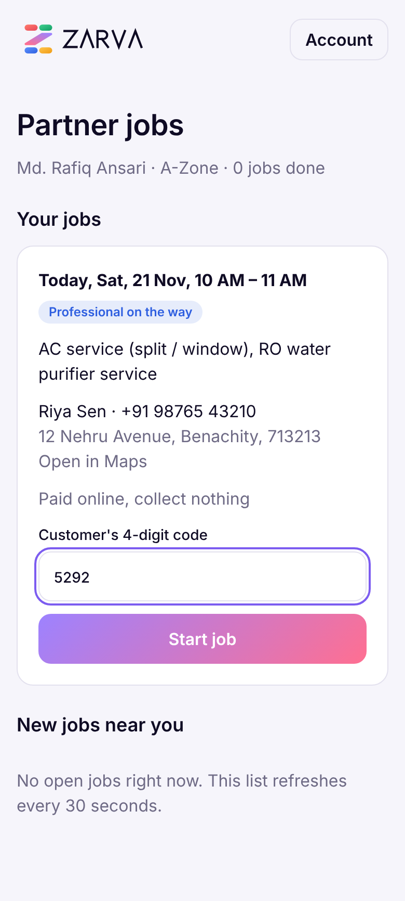

# Home services (vertical `home`)

Urban Company style bookings. Live in **Durgapur** (PIN 713201 to 713216). Asansol and Kolkata are in the database, switched off.

## Try it locally

Nothing extra to set up. Run `pnpm dev` as in the README. On first start the API loads the Durgapur catalogue and, in the built-in demo database only, 8 demo professionals. Sign-in codes print in the terminal.

| Role | Sign in as | Go to |
|---|---|---|
| Customer | any number, e.g. 98765 43210 | Home tile "Home services" → add to cart → checkout |
| Professional | 90000 00001 to 90000 00008 (see `seed-data.ts` for who does what) | http://localhost:3000/pro |
| Admin | 99999 00000 (local default, no authenticator code needed locally) | http://localhost:3000/admin |

Payments use the mock provider locally: "Pay now" succeeds instantly. To reload the catalogue after editing prices in `seed-data.ts`, run `pnpm db:seed` (add `-- --demo` for demo pros). To start over, stop the API and delete `apps/api/.data`.

## Who can do what (access rules)

All checks happen on the API for every request; hiding a button in the app is never the protection.

- **Customer**: anyone signed in. Booking needs a verified mobile number.
- **Professional**: anyone can apply at `/pro`, but sees no jobs and can't act until an admin approves them. Every partner API re-checks "approved, right city, right category, my job".
- **Admin**: three checks on every admin API call:
  1. signed in with a live session,
  2. the account's mobile number is verified by OTP and listed in `ADMIN_PHONES`,
  3. this session was unlocked with a 6-digit code from an authenticator app (Google/Microsoft Authenticator) in the last 8 hours. 5 wrong codes lock it for 15 minutes; a code can't be reused; logging out ends the unlock.

**Developer shortcuts** (demo admin 99999 00000, demo partners, demo Google button, instant mock payments) exist only on a developer's own machine: when sign-in codes are printed to the terminal instead of sent. As soon as real SMS or email is configured, or `NODE_ENV=production`, they all switch off, and the API refuses to start without a real `JWT_SECRET`, Razorpay, and an authenticator secret for every admin.

### Set up an admin for a real deployment

```
pnpm admin:2fa 9876543210
```

Scan or type the key into Google Authenticator on that admin's phone, then put the two printed lines (`ADMIN_PHONES`, `ADMIN_TOTP_SECRETS`) in the server's settings.

## How it works

- **Catalogue**: 8 categories, 41 services, prices in `apps/api/src/modules/home/seed-data.ts`. Prices include GST. Orders under ₹299 pay a ₹29 convenience fee; minimum order ₹99.
- **Serviceability**: decided by the address PIN code (`home_cities.pincodes`).
- **Slots**: 1-hour arrival windows, 8 AM to 8 PM IST, 7 days ahead, at least 2 hours from now. A slot is free while *bookings in that slot < active pros in that category*. A row lock per slot stops two customers taking the last pro.
- **Payment**: "Pay now" (Razorpay, UPI first) or "Pay after service" (pro collects cash/UPI and marks it). An unpaid online booking holds its slot for 15 minutes. The booking is confirmed by the client callback *or* the webhook, whichever comes first, inside the same database transaction as the payment change.
- **Job flow**: confirmed → pro accepts (or admin assigns) → on the way → pro enters the customer's 4-digit start code → in progress → completed. Before accepting, a pro sees only the area and PIN, not the customer's name, phone or house.
- **Cancellation**: free until 2 hours before the slot, with a full automatic refund if paid. After that, only admin can cancel.
- **Admin**: bookings by status, assign/reassign, cancel with reason, approve/suspend pros, edit prices, hide services.

## Known limits (deliberate for v1)

- Slot capacity counts bookings per slot start only. A 5-hour deep clean blocks its pro for one slot in the capacity count, though the pro still cannot accept two jobs at the same start time. Fix before cleaning volume grows: make capacity duration-aware.
- One price list for all cities. Add per-city prices before Kolkata.
- No push notifications or SMS on status changes yet: the web and app poll every 20-30 s.
- Mobile app: customer flow only. "Pay now" works with the mock provider; live Razorpay in the app needs `react-native-razorpay` and an Expo dev build. Until then use "Pay after service" in the app or pay on the web.
- Pros are paid outside the system (no payouts or commission ledger yet).
- Durgapur PIN list and prices should be checked locally before launch.

## Screenshots

| Categories | Checkout | Booking tracking | Partner job | Admin |
|---|---|---|---|---|
|  |  |  |  |  |
