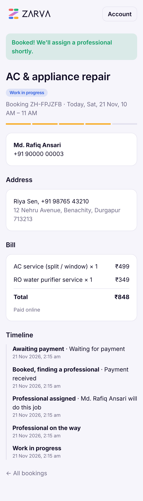
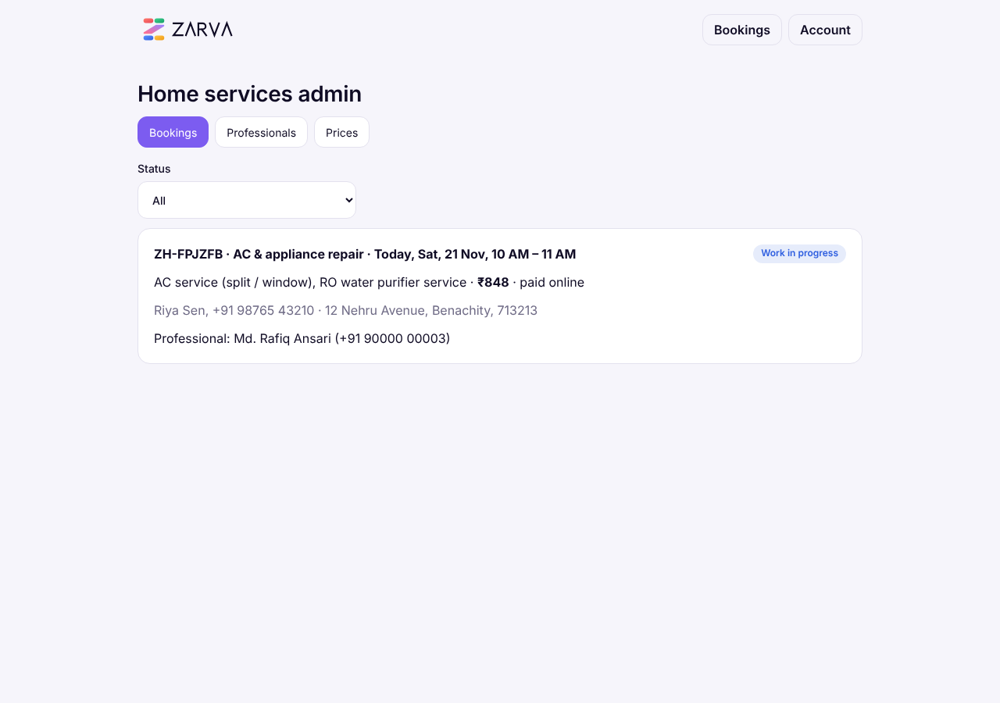

# Home services (vertical `home`)

Urban Company style bookings. Live in **Durgapur** (PIN 713201 to 713216). Asansol and Kolkata are in the database, switched off.

## Try it locally

After the normal setup in the README:

```bash
# in .env
ENABLED_MODULES=home
ADMIN_PHONES=9999900000          # any number you will sign in with as admin

pnpm db:migrate
pnpm db:seed -- --demo           # catalogue + 8 demo professionals (never use --demo in production)
pnpm dev:api
pnpm dev:web
```

OTP codes print in the API terminal. Three roles to try:

| Role | Sign in as | Go to |
|---|---|---|
| Customer | any number | Home tile "Home services" → add to cart → checkout |
| Professional | 9000000001 to 9000000008 (demo pros, see `seed-data.ts`) | `/pro` |
| Admin | a number in `ADMIN_PHONES` | `/admin` |

Payments use the mock provider in dev: "Pay now" succeeds instantly.

## How it works

- **Catalogue**: 8 categories, 41 services, prices in `apps/api/src/modules/home/seed-data.ts`. Prices include GST. Orders under ₹299 pay a ₹29 convenience fee; minimum order ₹99.
- **Serviceability**: decided by the address PIN code (`home_cities.pincodes`).
- **Slots**: 1-hour arrival windows, 8 AM to 8 PM IST, 7 days ahead, at least 2 hours from now. A slot is free while *bookings in that slot < active pros in that category*. A row lock per slot stops two customers taking the last pro.
- **Payment**: "Pay now" (Razorpay, UPI first) or "Pay after service" (pro collects cash/UPI and marks it). An unpaid online booking holds its slot for 15 minutes. The booking is confirmed by the client callback *or* the webhook, whichever comes first, inside the same database transaction as the payment change.
- **Job flow**: confirmed → pro accepts (or admin assigns) → on the way → pro enters the customer's 4-digit start code → in progress → completed. Before accepting, a pro sees only the area and PIN, not the customer's name, phone or house.
- **Cancellation**: free until 2 hours before the slot, with a full automatic refund if paid. After that, only admin can cancel.
- **Admin**: bookings by status, assign/reassign, cancel with reason, approve/suspend pros, edit prices, hide services.

## Known limits (deliberate for v1)

- Slot capacity counts bookings per slot start only. A 5-hour deep clean blocks its pro for one slot in the capacity count, though the pro still cannot accept two jobs at the same start time. Fix before cleaning volume grows: make capacity duration-aware.
- One price list for all cities. Add per-city prices before Kolkata.
- No push notifications or SMS on status changes yet: the web and app poll every 20-30 s.
- Mobile app: customer flow only. "Pay now" works with the mock provider; live Razorpay in the app needs `react-native-razorpay` and an Expo dev build. Until then use "Pay after service" in the app or pay on the web.
- Pros are paid outside the system (no payouts or commission ledger yet).
- Durgapur PIN list and prices should be checked locally before launch.

## Screenshots

| Categories | Checkout | Booking tracking | Partner job | Admin |
|---|---|---|---|---|
|  |  |  |  |  |
